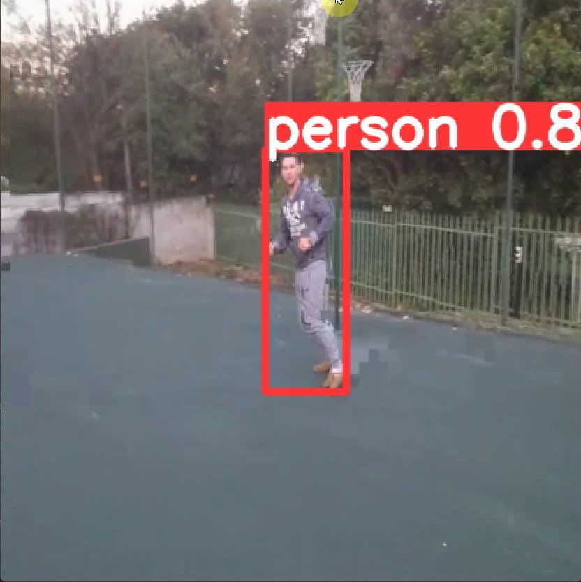
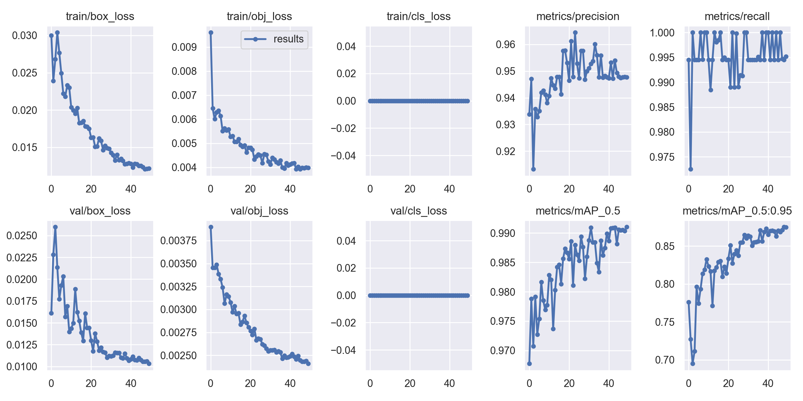
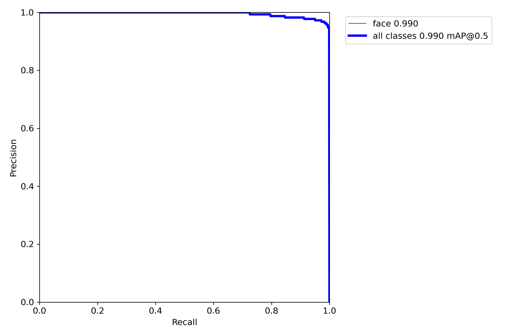

# Tello YOLOv5 Tracking

Face and person tracking for a DJI Tello using a shared YOLOv5 v6.1 detector and
proportional-derivative image-centering control. The original face and person
scripts had nearly identical inference and flight code; this repository
combines them behind a `--target` option.

## Project video

[Watch the Tello tracking project showcase](https://drive.google.com/file/d/1tz2XzvRAzNlpEgNxBHpcv9nIH4OkFTgG/view?usp=sharing)

The project demonstrates a complete visual feedback loop: the drone camera
provides frames, YOLOv5 locates a face or person, the controller measures the
target's horizontal and vertical image-centering error, and optional RC
commands adjust the drone's movement. Preview mode is the safe default; flight
commands require the explicit `--fly` option.

### Showcase highlights

- One shared YOLOv5 detector for face and person targets.
- A `416 x 416` detection input with a default confidence threshold of `0.40`.
- PD control for target centring, plus bounding-box area bands for
  forward/backward motion.
- A neutral-command fallback when no target is detected.
- CSV run logs and plots for target error, detection state and command
  behaviour.
- Preserved historical face-model plots with approximately 0.99 mAP@0.50 and
  0.87 mAP@0.50:0.95; the corresponding weights and training dataset are not
  included.

## Tracking operation

<p align="center">
  
  <br><em>Camera-view tracking demo: YOLOv5 detects a person and draws a bounding box.</em>
</p>

The YOLOv5 dependency is a Git submodule pinned to upstream commit
[`1156a323`](https://github.com/ultralytics/yolov5/commit/1156a323f8fc221d5c1a36c700e72e129419d187).
Its source and AGPL-3.0 license remain in the submodule. This repository does
not include model weights or the face dataset.

## Setup

Use Python 3.10 and clone with the submodule:

```powershell
git clone --recurse-submodules <repository-url>
cd tello-yolov5-tracking
python -m venv .venv
.\.venv\Scripts\Activate.ps1
python -m pip install --upgrade pip
python -m pip install -r requirements.txt
```

If you already cloned without submodules:

```powershell
git submodule update --init --recursive
```

## Person tracking

YOLOv5 downloads the standard `yolov5s.pt` checkpoint when it is first needed.
The tracker defaults to preview mode: it connects to the Tello video stream but
does not take off or send flight commands.

```powershell
python track_drone.py --target person
```

To fly, connect to the Tello, clear the area, and explicitly add `--fly`:

```powershell
python track_drone.py --target person --fly --duration 60
```

Press `q` in the preview window to end early. The program stops the RC command,
attempts to land, and shuts down the video stream when it exits.

## Face tracking

Face tracking needs the custom face detector checkpoint, which is intentionally
not included. Supply a compatible weights file and, if needed, its data YAML:

```powershell
python track_drone.py --target face --weights PATH\TO\best.pt --data PATH\TO\data.yaml
```

The face model, Roboflow export, and training dataset are excluded. The
preserved training and flight plots are historical artifacts; they do not
reproduce the omitted model or dataset.

## Webcam preview

Use the same model and detector on a local webcam without connecting to a drone:

```powershell
python webcam_demo.py --target person
python webcam_demo.py --target face --weights PATH\TO\best.pt
```

## Preparing images

Extract video frames for manual annotation:

```powershell
python tools\extract_frames.py --video PATH\TO\flight.mp4 --output-dir data\frames --every 10
```

The tool only extracts frames; it does not create labels or automatically
assign detections as ground truth.

## Logs and plots

Each run saves a CSV and plots under `runs/tracking/<timestamp>/`. The logged
`Y Speed` series uses the vertical command rather than duplicating `X Speed`.
`tests/test_tracking_control.py` checks the pure control calculations without
requiring a drone or model weights.

Selected historical flight traces:


The following training artifacts come from the original custom face-model run;
the model weights and dataset are not included:





## Repository contents

- `track_drone.py` — Tello preview and optional face/person flight tracking.
- `detector.py` — shared YOLOv5 v6.1 inference.
- `tracking_control.py` — target-specific controller profiles and RC commands.
- `webcam_demo.py` — camera-only preview.
- `tools/extract_frames.py` — frame extraction for manual labeling.
- `assets/` — selected historical flight and training plots.

## Attribution and licensing

The YOLOv5 source is provided as a submodule from
[ultralytics/yolov5](https://github.com/ultralytics/yolov5) at the pinned
commit above and carries its own AGPL-3.0 license. DJI Tello control uses
[djitellopy](https://github.com/damiafuentes/DJITelloPy).

No separate license is declared for the project files at the repository root.
